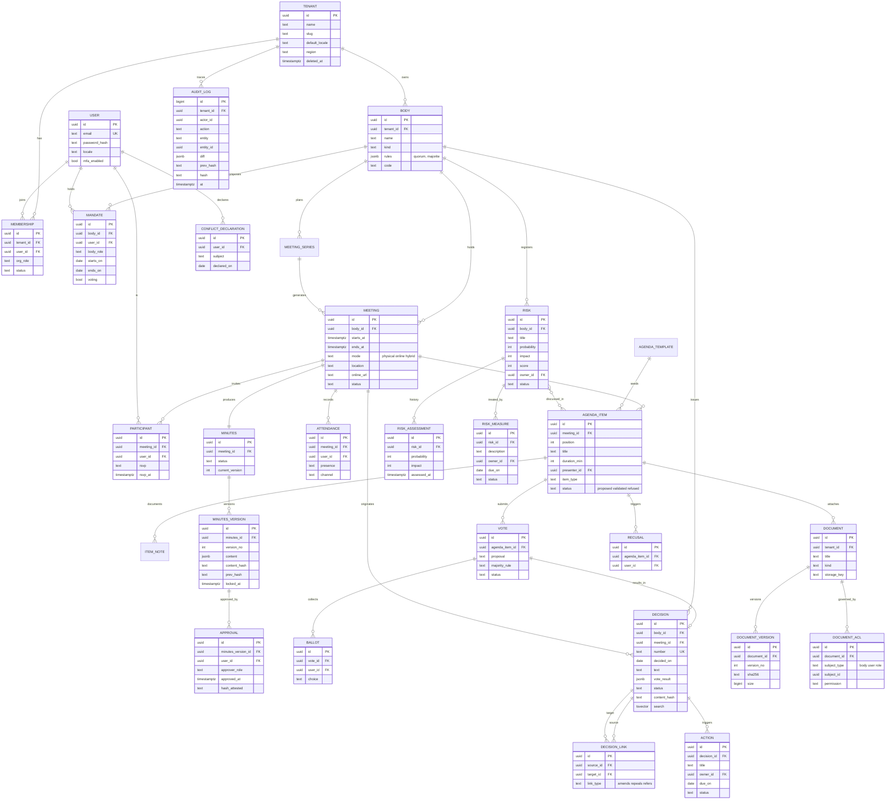

# 03 – Modèle de domaine et modèle de données

## 1. Contextes (modules du monolithe)

| Module | Agrégats principaux |
|---|---|
| `identity` | user, session, mfa_credential, invitation |
| `tenancy` | tenant, membership, tenant_settings |
| `bodies` | body, mandate |
| `meetings` | meeting_series, meeting, participant, convocation |
| `agenda` | agenda_template, agenda_item |
| `minutes` | item_note, attendance, minutes, minutes_version, approval |
| `decisions` | decision, decision_link, vote, ballot |
| `risks` | risk, risk_assessment, risk_measure |
| `actions` | action |
| `documents` | document, document_version, document_acl |
| `governance` | conflict_declaration, recusal |
| `audit` | audit_log |
| `notifications` | notification, outbox_email |

## 2. Règles structurantes

- Toute table métier porte `tenant_id uuid not null` et une politique RLS (ADR-0002). Exceptions globales : `user`, `session`, `mfa_credential`.
- Clés primaires : `uuid` v7. Horodatages en UTC (`timestamptz`) ; fuseau d'affichage par séance (`Europe/Zurich` par défaut).
- Suppression logique (`deleted_at`) sauf pour les objets immuables, jamais supprimables.
- **Immutables** (triggers `BEFORE UPDATE/DELETE` qui lèvent une exception) : `decision` (sauf colonne dérivée `status`, mise à jour uniquement par la fonction `apply_decision_link`), `minutes_version` quand `locked_at` est non nul, `approval`, `ballot` d'un vote clos, `audit_log`.
- **Hash** : `content_hash` = SHA-256 du contenu canonique (JSON trié). `prev_hash` chaîne les versions d'un PV et les entrées du journal d'audit par tenant.
- Tout lien « point d'ODJ ↔ risque / décision / action » est une table de jonction explicite.
- Contraintes composites `(tenant_id, id)` + FK composites pour empêcher une référence inter-tenants même hors RLS.

## 3. Diagramme ER (simplifié)

## 4. Points d'attention de modélisation

1. **Composition de l'organe à une date** : requête sur `mandate` (`starts_on ≤ d ≤ coalesce(ends_on, ∞)`). Au passage d'une séance en « convoquée », on fige les `participant` ; le quorum se calcule sur les `attendance` + mandats votants à la date de séance, hors `recusal`.
2. **Numérotation des décisions** : table `decision_counter(tenant_id, body_id, year, last)` incrémentée sous verrou de ligne, pour éviter doublons et trous.
3. **Statut de décision** : dérivé des `decision_link` (`amends`, `repeals`) par une fonction SQL appelée par le service, jamais par édition libre.
4. **PV** : `content` JSON structuré (en-tête, présences, points, décisions, votes, annexes). Le PDF est un rendu déterministe ; le hash du PDF est conservé avec la version.
5. **Documents** : un fichier n'est jamais écrasé ; une nouvelle version crée une ligne et un objet S3 `tenant/{id}/doc/{docId}/{versionNo}`.
6. **Recherche** : colonnes `tsvector` (config `simple` + `unaccent`, plus config par langue du tenant) avec index GIN, sous RLS.
7. **Journal d'audit** : écrit par trigger **et** par le service pour les événements applicatifs (connexion, export, changement de rôle).
