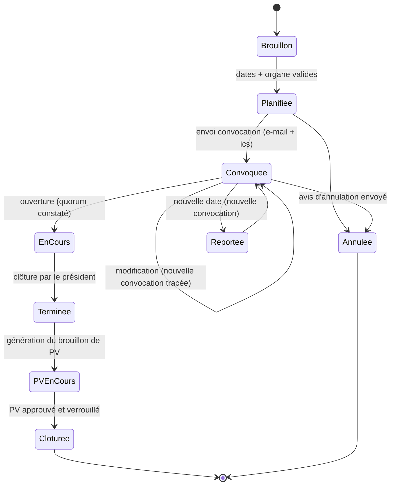
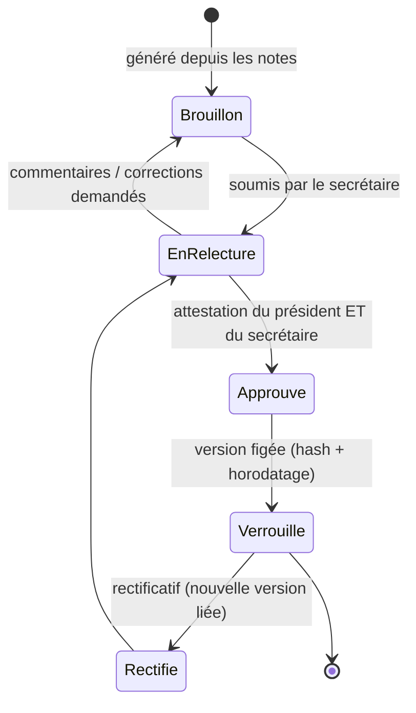
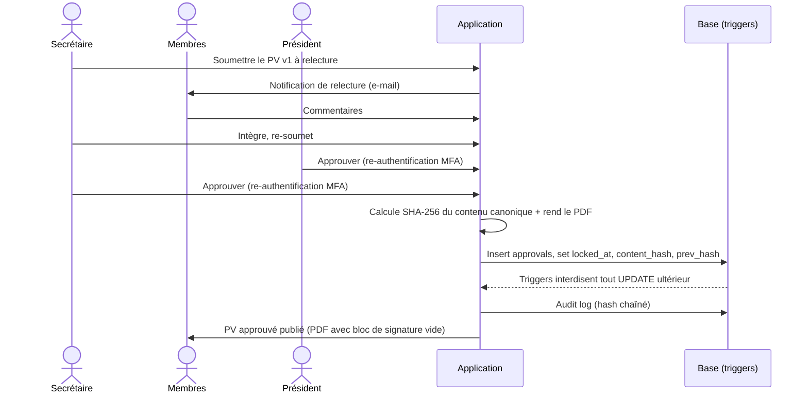
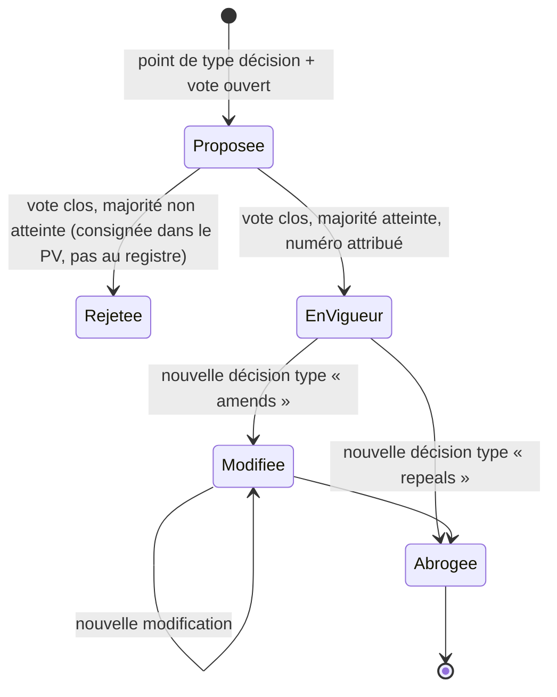
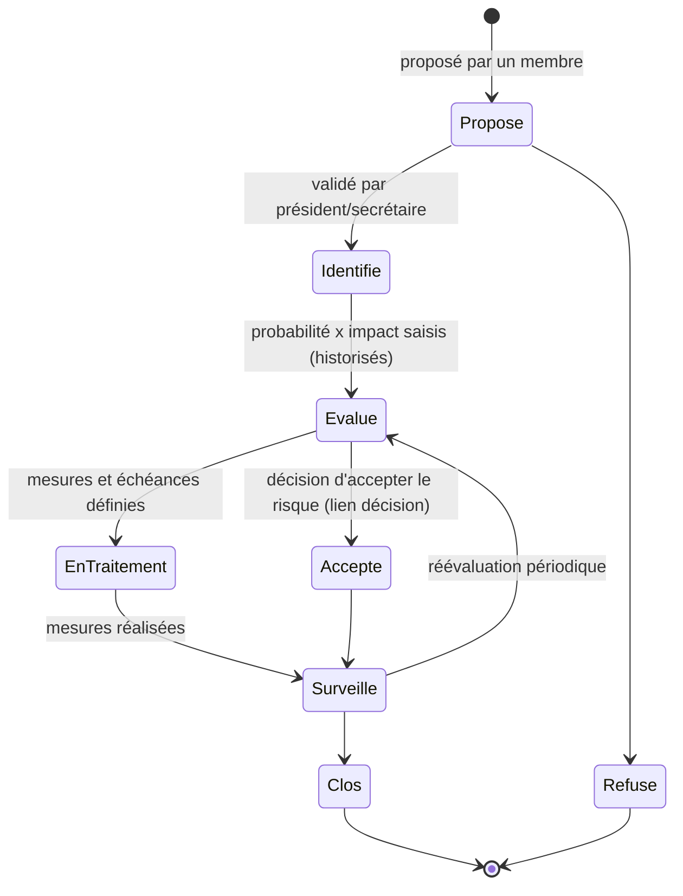
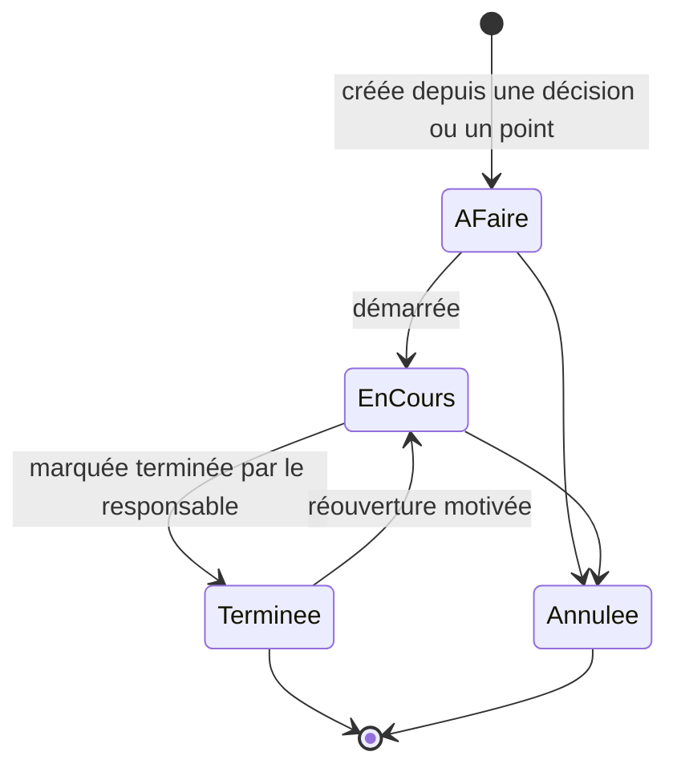
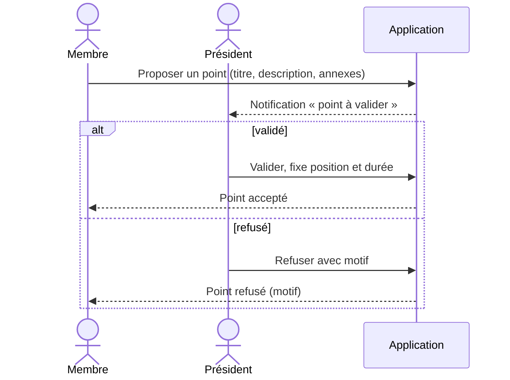

# 05 – Workflows clés

## 1. Cycle de vie d'une séance

Règles : le quorum non atteint maintient la séance « en cours » en mode « délibération impossible » (les votes sont bloqués, les points d'information restent possibles). Une convocation modifiée après envoi génère une nouvelle convocation avec la mention « mise à jour ». Une séance « clôturée » est en lecture seule.

## 2. Approbation du PV

Règles : l'approbation exige une **ré-authentification** (mot de passe ou TOTP) dans les 5 minutes. Toute modification du contenu après la première attestation réinitialise les attestations. Un rectificatif crée la version n+1 avec `prev_hash` pointant sur la version précédente.

## 3. Cycle de vie d'une décision

Règles : le texte d'une décision ne change **jamais**. « Modifiée » et « abrogée » sont des statuts dérivés de liens vers une nouvelle décision. Une décision issue d'une séance dont le PV n'est pas encore approuvé est marquée « en attente d'approbation du PV » dans l'affichage, mais reste enregistrée.

## 4. Cycle de vie d'un risque

Règles : chaque réévaluation crée une ligne `risk_assessment` (historique conservé). Un risque critique (> 15) sans mesure ni échéance apparaît en alerte au tableau de bord. Un risque peut être lié à plusieurs points d'ODJ.

## 5. Cycle de vie d'une action

Règles : « en retard » est un **état dérivé** (échéance dépassée et statut non terminal), pas un statut stocké. Relances e-mail : J-3, J+1, puis hebdomadaires pendant 4 semaines, via le job `action-reminders`. Un report d'échéance est tracé (ancienne, nouvelle, motif).

## 6. Proposition d'un point par un membre

Règle : un point proposé n'apparaît pas dans la convocation tant qu'il n'est pas validé ; la date limite de proposition est paramétrable par organe.
