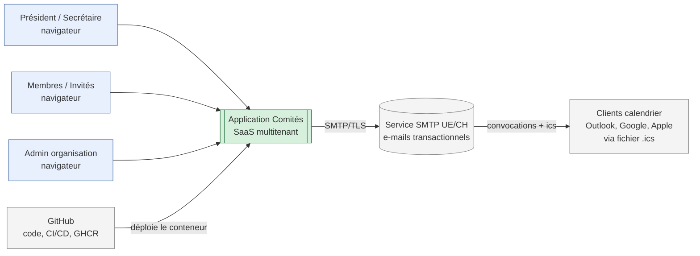
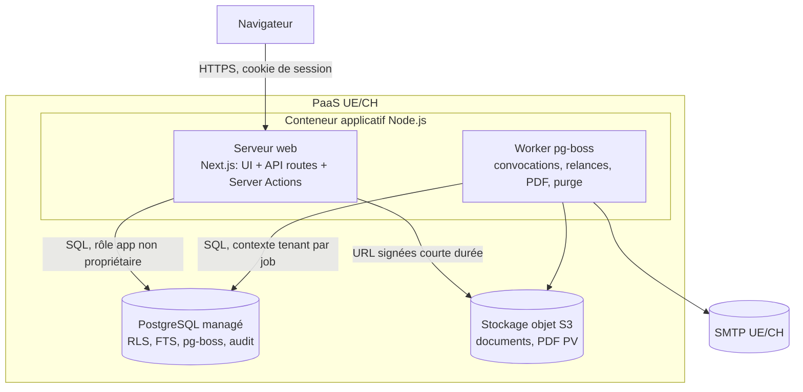
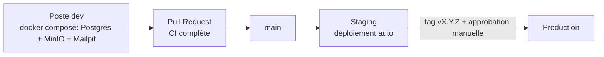

# 06 – Architecture (C4)

## Niveau 1 – Contexte



## Niveau 2 – Conteneurs

Principe : **1 conteneur applicatif**, **1 PostgreSQL managé**, **1 stockage objet S3**, **1 SMTP**. Le même conteneur démarre le serveur web et le worker de jobs (processus unique au MVP, séparable plus tard par variable d'environnement `ROLE=web|worker|all`).



| Conteneur | Techno | Rôle |
|---|---|---|
| Web | Next.js (App Router), React, TypeScript strict | UI, Server Actions, routes API, i18n (`next-intl`) |
| Worker | pg-boss (file de jobs dans PostgreSQL) | E-mails, `.ics`, relances, rendu PDF, export tenant, purge |
| Base | PostgreSQL 16+ | Données, RLS, FTS, jobs, audit |
| Objets | S3 compatible (UE/CH) | Annexes, PDF ; clé `tenants/{tenant_id}/…` |

## Niveau 3 – Composants (monolithe modulaire)

```mermaid
flowchart TB
    subgraph Web
      UI[UI React + i18n]
      ACT[Server Actions / API routes]
    end
    subgraph Noyau
      CTX[tenant-context<br/>résolution tenant + SET LOCAL]
      AUTHN[auth: sessions, Argon2id, TOTP]
      AUTHZ[authz: can(user, action, resource)]
      AUD[audit: log chaîné]
      OUT[outbox + jobs]
    end
    subgraph Modules métier
      ID[identity] --- TEN[tenancy] --- BOD[bodies/mandates]
      MTG[meetings] --- AGD[agenda]
      MIN[minutes] --- DEC[decisions/votes]
      RSK[risks] --- ACN[actions]
      DOC[documents] --- GOV[governance]
      NOT[notifications]
    end
    subgraph Infra
      DBA[db: Drizzle + migrations SQL]
      STO[storage: S3 adapter]
      MAIL[mail: SMTP adapter + ics]
      PDF[pdf: renderer déterministe]
      SRCH[search: FTS]
    end
    UI --> ACT --> CTX --> AUTHN --> AUTHZ
    AUTHZ --> Modules
    Modules --> DBA
    Modules --> AUD
    Modules --> OUT
    DOC --> STO
    NOT --> MAIL
    MIN --> PDF
    DEC --> SRCH
```

### Règles d'architecture (vérifiées en CI par `dependency-cruiser`)

1. Un module n'importe **que** l'interface publique (`index.ts`) d'un autre module ; pas d'accès croisé aux tables d'autrui sans passer par son service.
2. Seul `db/` ouvre des connexions ; tout accès SQL passe par `withTenant(tenantId, fn)` qui ouvre une transaction et exécute `select set_config('app.tenant_id', $1, true)`.
3. Aucun module n'accède directement à S3, SMTP ou au système de fichiers : adaptateurs uniquement (swappables pour portabilité).
4. Les jobs reçoivent `tenantId` dans leur payload et appellent `withTenant` ; un job sans `tenantId` est rejeté.
5. Le cache, s'il apparaît, est préfixé `t:{tenantId}:`. Au MVP : pas de cache partagé, seulement des caches en mémoire par requête.
6. Les journaux applicatifs incluent `tenant_id`, `user_id`, `request_id` ; jamais de contenu de PV, mot de passe ou jeton.

## Déploiement et environnements



## ADR

| ADR | Décision |
|---|---|
| [0001](adr/0001-monolithe-modulaire-typescript.md) | Monolithe modulaire TypeScript (Next.js + Drizzle) |
| [0002](adr/0002-multitenance-rls.md) | Base partagée + `tenant_id` + RLS |
| [0003](adr/0003-authentification.md) | Authentification login/mot de passe + TOTP, sessions en base |
| [0004](adr/0004-jobs-pg-boss.md) | Jobs dans PostgreSQL (pg-boss), sans Redis |
| [0005](adr/0005-stockage-fichiers.md) | Stockage S3 UE, accès via URL signées |
| [0006](adr/0006-immutabilite-hash.md) | Immutabilité par triggers + versions + hash chaîné |
| [0007](adr/0007-hebergement-paas.md) | Hébergement PaaS UE (options et coûts) |
| [0008](adr/0008-recherche-pdf-i18n.md) | Recherche FTS, PDF, i18n |
| [0009](adr/0009-email-ics.md) | E-mail SMTP et invitations `.ics` |
